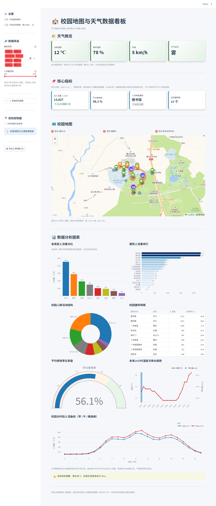
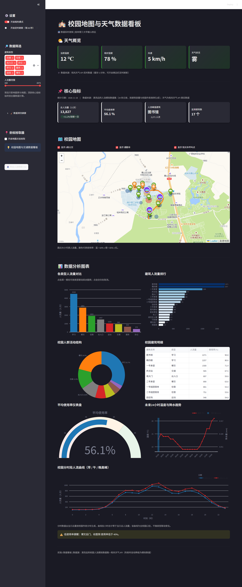

# 校园地图与天气数据看板（实验2 数据看板的设计与实现）

基于 Streamlit + Pandas + Plotly 实现的校园数据看板，围绕"桂林理工大学雁山校区"的**校园人流**与**天气**两条数据线，完成实验要求的五大基础任务：需求分析与版面设计、数据准备与预处理、基础图表搭建、静态看板整合、结果验证与总结。

在线演示：<https://campusdashboardmap-2fkcmvsprdpzxxvjumj7uy.streamlit.app/>

## 实验任务对照

| 指导书任务 | 本项目对应实现 | 位置 |
| --- | --- | --- |
| 任务1 需求分析与版面设计 | 业务场景、四大模块划分、配色方案、版面草图 | `docs/需求澄清与版面设计.md` |
| 任务2 数据准备与预处理 | 原始模拟数据（含故意注入的脏数据）+ 清洗脚本 + 清洗报告 | `data/campus_flow_raw.csv`、`data/preprocess.py`、`data/campus_flow_clean.csv` |
| 任务3 基础可视化图表 | 天气 4 卡、核心指标卡、分类柱状图、排行条形图、使用率仪表盘、温度降水双轴折线、分时人流曲线、环形饼图、明细表 | `app.py`、`charts/analytics.py` |
| 任务4 静态看板整合 | 单页整合天气 / 概览 / 地图 / 统计 / 趋势 / 明细 / 分时七个区域，统一配色与卡片样式 | `app.py` |
| 任务5 结果验证与总结 | 截图存档 + 数据准确性核对 + `AppTest` 断言 + 问题与解决记录 | `docs/images/`、`docs/实验报告.md`、`docs/复盘.md` |

## 页面结构

```
┌───────────────────────────────────────────────┐
│ 标题：校园地图与天气数据看板                     │
├───────────────────────────────────────────────┤
│ 天气概览区：温度 / 湿度 / 风速 / 天气状况        │
│            （4 张绿色强调卡置顶）+ 数据来源 + 预警 │
├───────────────────────────────────────────────┤
│ 数据概览区：总人流量 / 平均使用率 / 峰值建筑 / 建筑数 │
├───────────────────────────────────────────────┤
│ 地图区：高德底图 + 5路公交 / 观光车 / 通勤车       │
│         + 建筑人流圆点（大小=人流，颜色=使用率）    │
├───────────────────────────────────────────────┤
│ 维度统计区：类型人流柱图 | 建筑人流排行条形图      │
│ 趋势分析区：使用率仪表盘 | 24 小时温度降水双轴折线  │
├───────────────────────────────────────────────┤
│ 明细数据区：人员活动结构环形饼图 | 建筑明细表       │
├───────────────────────────────────────────────┤
│ 分时分析区：校园分时段人流曲线（双日对比）         │
└───────────────────────────────────────────────┘
```

配色方案：主色 `#1f77b4`（蓝），辅助色 `#ff7f0e`（橙），背景色 `#f5f7fa`（浅灰蓝），卡片底色 `#ffffff`；暗色模式另有一套配色（背景 `#1a1a24`、卡片 `#2a2a35`）。

交互方式：侧边栏「建筑类型」多选 + 「人流量范围」滑块做两级筛选，筛选后地图/图表/表格同步刷新；图表区**点击「各类型人流量对比」的柱子**可按类型联动其余图表与地图（点空白或按「取消联动」复位）；另可切换亮/暗主题、开启每 60 秒天气局部刷新。

## 项目结构

```
campus_dashboard_map/
├── app.py                       # 看板主程序（页面整合与交互）
├── config.py                    # 密钥读取（Streamlit secrets / 环境变量）+ 配色
├── charts/
│   ├── analytics.py             # 图表层：柱、条形、饼、折线、仪表盘、分时曲线、明细表
│   └── map_view.py              # 地图层：folium 地图与公交/观光车/通勤车/建筑点位
├── data/
│   ├── campus_flow_raw.csv      # 原始模拟数据（47 行，含 13 条注入脏数据）
│   ├── campus_flow_clean.csv    # 清洗后数据（34 行，看板实际读这份）
│   ├── campus_flow_hourly.csv   # 分时数据（48 行，2 天 × 24 小时）
│   ├── preprocess.py            # 数据预处理：清洗、去重、越界处理、指标计算
│   ├── mock.py                  # 建筑坐标、公交站点、观光车/通勤车点位
│   └── weather.py               # 和风天气接口，失败自动降级并明示演示数据
├── tools/
│   └── generate_flow_dataset.py # 数据生成（容量反算 + 固定种子，可完整复现）
├── docs/                        # 需求澄清、实验报告、测试用例、复盘、AI 对话记录
│   ├── 需求澄清与版面设计.md     # 任务1：场景、需求、模块、配色、版面草图
│   ├── 实验报告.md               # 任务5：数据准确性核对 + 截图 + 交付清单
│   ├── 测试用例.md               # TC-01 ~ TC-30 执行记录
│   ├── 复盘.md                   # 问题、根因与改进项（含第二轮整改）
│   ├── ai对话记录.md             # 第一轮协作过程（含时效说明）
│   └── images/                   # 亮色 / 暗色整页截图（第一版数据集时期）
└── requirements.txt             # 已固定版本，避免云端部署装到不同版本
```

## 运行方式

```bash
pip install -r requirements.txt

# 首次运行（或修改原始数据后）先重建清洗结果
python -m data.preprocess

# 启动看板
streamlit run app.py
```

看板默认打开 `http://localhost:8501`。

密钥配置（可选）：不配置也能跑，天气接口会自动降级为模拟数据、地图公交线路退回手工拐点。

```toml
# .streamlit/secrets.toml（已被 .gitignore 排除）
AMAP_KEY = "..."
QWEATHER_KEY = "..."
QWEATHER_HOST = "..."
```

## 数据说明

| 文件 | 用途 | 说明 |
| --- | --- | --- |
| `data/campus_flow_raw.csv` | 原始数据 | 17 个校园点位 × 2 天，另含 13 条故意注入的脏数据（共 47 行） |
| `data/campus_flow_clean.csv` | 清洗结果 | 34 行，看板唯一数据源，卡片/图表/表格/地图全部读它 |
| `data/campus_flow_hourly.csv` | 分时数据 | 48 行（2 天 × 24 小时），各小时合计等于当日总人流 |
| `data/preprocess.py` | 清洗脚本 | 可单独运行，输出清洗报告 |
| `tools/generate_flow_dataset.py` | 数据生成 | 固定种子（`md5(建筑|日期)`），可完整复现上述三份数据 |

清洗规则（详见 `data/preprocess.py` 顶部注释）：

1. 文本去首尾空格，日期统一为 `YYYY-MM-DD`
2. 关键列（日期 / 建筑名称 / 类型 / 人流量）缺失的行剔除
3. 人流量限 `[0, 5000]`、使用率限 `[0, 100]`，越界置空后按同类型中位数填补
4. 不在校园建筑清单内的点位剔除（无坐标无法上图）
5. 按（日期，建筑名称）去重，保留首条

实测清洗报告（`python -m data.preprocess` 输出）：

```
原始数据 47 行 → 清洗后 34 行
- 剔除关键字段缺失行：3 条
- 数值越界：人流量 2 条、使用率 1 条 → 置空后按同类型中位数填补
- 中位数填补空值：4 个
- 剔除建筑清单外的点位：2 条（无坐标无法上图）
- 按 (日期, 建筑名称) 去重：删除 8 条
```

核心指标（清洗后 2026-11-18 口径）：总人流量 **14,103 人次**、平均使用率 **56.1%**、较前一日 **+10.7%**、峰值建筑 **图书馆（2,271 人次 / 90.8%）**、监测建筑 **17 个**。

使用率统一按 `人流量 ÷ 建筑日累计容量 × 100` 反算（容量表见 `tools/generate_flow_dataset.py` 与 `docs/实验报告.md` §3.4），任取一行都可当场验算，例如 `2271 ÷ 2500 = 90.8%`。

> 建筑分类口径：行知楼是行政办公楼（学工处、教务处办事窗口、报告厅所在），归"办公"类，日累计约 370 人次；教学楼与图书馆归"学习"类，合计 4,528 人次，是 8 个类型中最高的。

## 截图

> 下列两张整页截图采集于**第一版数据集**时期，页面结构与配色同当前版本，仅数字不同（数据集此后经过两轮重构）。当前线上版本见文首"在线演示"。

**亮色模式（整页）**



**暗色模式（整页）**




## 已知限制

- 人流数据为**按建筑容量与作息规律生成的模拟数据**（固定种子可复现，使用率由人流量反算，可当场验算），不是真实校园门禁数据
- 天气接口依赖和风天气密钥；未配置时降级为模拟天气，页面会显示红色"演示数据"提示框，不会把假数据当真实数据展示
- 高德底图瓦片来自公共服务，离线或断网时地图底图为空白，点位与线路仍可见
- 建筑类型与人流量区间筛选会同时影响图表与地图，但顶部核心指标始终为全量口径（页面已注明）
- 60 秒定时刷新只重跑天气区块（`@st.fragment`），接口失败时会保留上一次成功值并缓存 5 分钟

## 文档索引

- `docs/需求澄清与版面设计.md` —— 任务1：场景、需求、模块、配色、版面草图
- `docs/实验报告.md` —— 任务5：完整实验报告（目的、步骤、数据口径、结果核对）
- `docs/ai对话记录.md` —— 开发过程的 AI 协作记录（第一轮，含时效说明）
- `docs/测试用例.md` —— 数据与页面的验证记录（TC-01 ~ TC-30）
- `docs/复盘.md` —— 问题、风险与改进项（含第二轮整改）
- 个人博客 —— <https://qls-eng.github.io/2026/10/17/python-vibe-coding-lab2-dashboard.html>
