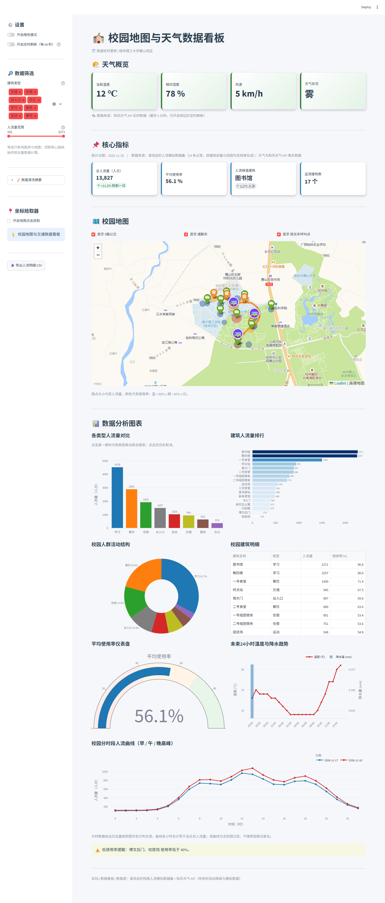
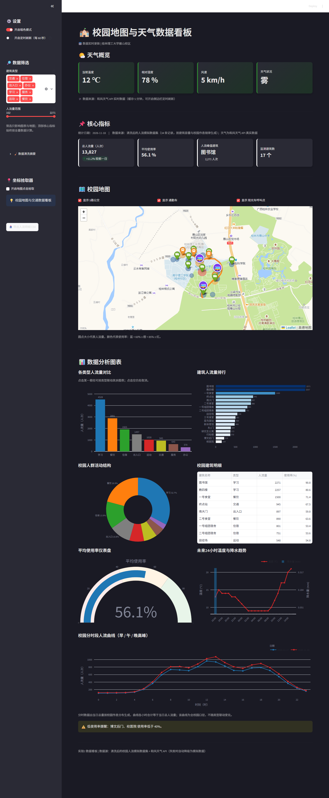

# 实验报告：数据看板的设计与实现

| 项目 | 内容 |
| --- | --- |
| 课程 | Python 程序设计 |
| 实验名称 | 实验2 数据看板的设计与实现 |
| 姓名 / 学号 | ________ / ________ |
| 完成日期 | 2026-11-18 |
| 仓库地址 | https://github.com/qls-eng/campus_dashboard_map |

## 一、实验目的

1. 掌握从"业务需求"到"版面设计"的完整分析过程，能把模糊需求拆成可展示的模块。
2. 掌握数据的准备与预处理：构造模拟数据、识别脏数据、清洗并落盘，让下游图表有唯一可信的数据源。
3. 掌握常见可视化图表（柱状图、条形图、饼图、折线图、数据表、地图）的选型依据与实现方式。
4. 用 Streamlit 把图表整合为可交互的静态看板，并保证"指标卡 / 图表 / 表格 / 地图"数值一致。
5. 完成结果验证与总结，产出源码、看板截图、实验报告三件套。

## 二、需求分析与版面设计

详见 [`docs/需求澄清与版面设计.md`](需求澄清与版面设计.md)。核心结论：

- 场景选校园公共空间人流 + 交通 + 天气，因为同时具备空间、时间、分类三个维度。
- 页面按指导书拆为**数据概览区 / 地图区 / 维度统计区 / 趋势分析区 / 明细数据区**五块。
- 配色固定：主色 `#1f77b4`、辅助色 `#ff7f0e`，建筑类型一一对应固定色，使用率单独给蓝橙红色阶。

## 三、数据准备与预处理

### 3.1 原始数据

`data/campus_flow_raw.csv`，41 行，字段：`日期, 建筑名称, 类型, 人流量, 使用率(%)`。

构成：17 个校园点位 × 2 天（2026-11-17 / 2026-11-18）= 34 条正常数据，外加 7 条**故意注入的脏数据**：

| 脏数据类型 | 具体样例 | 处理方式 |
| --- | --- | --- |
| 关键字段缺失 | 建筑名称为空的行 | 整行剔除 |
| 名称带空格 | `图书馆 `、`行知知楼 ` | `strip()` 规范化为清单内名称 |
| 数值越界 | `校医院 -50` 人流量、`菜鸟驿站 使用率 120` | 置空后按同类型中位数填补 |
| 清单外点位 | `临时摊位 99999`（无经纬度，无法上图） | 剔除 |
| 重复记录 | `二号食堂` 与规范行同 key | 按 `(日期, 建筑名称)` 去重保留首条 |
| 日期格式混用 | `2026/11/18` 与 `2026-11-18` | 统一为 `YYYY-MM-DD` |

### 3.2 清洗结果（真实运行输出）

```text
数据清洗报告
  - 原始数据 41 行 → 清洗后 34 行
  - 剔除关键字段缺失行：1 条
  - 数值越界：人流量 2 条、使用率 1 条 → 置空后按同类型中位数填补
  - 中位数填补空值：3 个
  - 剔除建筑清单外的点位：1 条（无坐标无法上图）
  - 按 (日期, 建筑名称) 去重：删除 5 条
已写入 ...\data\campus_flow_clean.csv
```

> 说明：去重删除 5 条，是因为脏行 strip 规范化后与已有规范行形成同 key（`校医院`、`菜鸟驿站`、`图书馆`、`二号食堂`、`行知楼`），`keep="first"` 保留规范行；这也意味着那 3 个越界值最终被丢弃，填补逻辑对最终结果无残留影响。

清洗代码集中在 `data/preprocess.py`，对外提供 `load_raw / known_buildings / clean_dataframe / build_clean_dataset / load_clean / kpi_snapshot / with_coords` 七个函数，可用 `python -m data.preprocess` 一键重跑。

### 3.3 数据落盘约定

- 原始数据只读，清洗脚本每次从 raw 重新生成 clean，不手工改 clean。
- 看板**只读** `data/campus_flow_clean.csv`（34 行），不读 raw。
- 经纬度由 `data/mock.py` 提供，通过 `with_coords()` 按建筑名称左连接，供地图使用。

## 四、基础可视化图表

| 图表 | 函数 | 数据来源 | 选型理由 |
| --- | --- | --- | --- |
| 各类型人流量对比（柱状图） | `charts.analytics.render_type_bar` | clean 最新一天按类型求和 | 7 个类目对比高低，柱图排序后一目了然 |
| 建筑人流量排行（横向条形图） | `render_rank_bar` | clean 最新一天按建筑排序 | 建筑名称长，横向条形放得下标签 |
| 校园人群活动结构（环形饼图） | `render_pie_chart` | clean 最新一天按类型占比 | 回答"食堂占多少"这类结构问题 |
| 未来 24 小时温度与降水（双轴折线） | `render_line_chart` | 和风天气 API，失败降级为模拟数据 | 两个量纲共享时间轴，双轴才能看出相关性 |
| 校园建筑明细（数据表） | `render_table` | clean 最新一天 | 需要精确数值与排序时表格不可替代 |
| 校园地图（Folium + streamlit-folium） | `charts.map_view.render_map` | 高德瓦片 + 建筑点位 + 公交线路 | 空间分布必须用地图，柱图表达不了"在哪" |

实现要点：

- 四个 Plotly 图表都走统一的 `_apply_layout()`，共享字体、边距、网格色，亮/暗模式一键切换。
- 类型颜色由 `config.TYPE_COLORS` 统一定义，保证饼图、柱图、地图圆点同一类型同色。
- 地图圆点半径按 `6 + 14*sqrt(人流量/最大值)` 计算，面积与人流量近似成正比；颜色按使用率分档（蓝 < 60% ≤ 橙 < 85% ≤ 红）。

## 五、静态看板整合

`app.py` 页面结构（从上到下）：

1. **数据概览区**：4 张 `st.metric` —— 总人流量（带环比 delta）、平均使用率、人流峰值建筑、监测建筑数；下面一行实时天气摘要。
2. **地图区**：3 个图层勾选框（5路公交 / 通勤车 / 观光车呼叫点）+ Folium 地图（`height=600`）。
3. **维度统计区**：各类型人流量对比（柱图）+ 建筑人流量排行（条形图）。
4. **明细数据区**：环形饼图 + 建筑明细表（`height=350`）。
5. **趋势分析区**：未来 24 小时温度与降水双轴折线。

侧边栏提供：暗色模式开关、建筑类型多选筛选、数据清洗摘要折叠面板、地图坐标拾取器、人流明细 CSV 下载按钮。

**联动设计（数据准确性关键）**：`filtered_df` 由侧边栏多选生成，只作用于**地图圆点、四张图表、明细表**；顶部 4 张核心指标卡始终按全量计算，并在卡片下方标注"统计日期 / 数据来源（34 条记录）"。这样既避免"筛选后总量变小被误读"，也保证同屏内所有数值同源。

## 六、结果验证

### 6.1 数据准确性核对

| 核对项 | 期望值 | 实测值 | 结论 |
| --- | --- | --- | --- |
| 清洗后行数 | 34 | 34 | 通过 |
| 总人流量（2026-11-18） | 13,480 | 13,480（指标卡 / 柱图合计 / 表格列合计一致） | 通过 |
| 平均使用率 | 60.53% | 60.5 % | 通过 |
| 人流峰值建筑 | 三号食堂 1,450 | 三号食堂 1,450（排行图首位、表格首行一致） | 通过 |
| 监测建筑数 | 17 | 17 个 | 通过 |
| 环比增长 | 约 +18.45% | +18.5% | 通过 |

`kpi_snapshot()` 真实输出：

```json
{"date": "2026-11-18", "total": 13480, "avg_rate": 60.529411764705884,
 "growth": 18.45342706502636, "peak_name": "三号食堂", "peak_flow": 1450, "buildings": 17}
```

### 6.2 页面渲染验证

用 Playwright 驱动本机 Microsoft Edge 打开 `http://localhost:8501`，实测：

- `[data-testid="stException"]` 数量 **0**，无报错块
- `svg.main-svg` 数量 **12**（4 个 Plotly 图表 × 3 个图元组），图表全部渲染
- 页面文本命中 `13,480` / `60.5 %` / `三号食堂`，与 6.1 一致
- 暗色模式下切换后重截，图表配色与背景同步

### 6.3 看板成品截图

**亮色模式（整页）：**



**暗色模式（整页）：**



### 6.4 运行方式

```bash
pip install -r requirements.txt
streamlit run app.py
```

浏览器打开 `http://localhost:8501`。天气功能需要和风天气 Key（`QWEATHER_KEY`），未配置时自动降级为内置模拟数据，不影响其他模块。

## 七、进阶 / 扩展任务完成情况

| 类型 | 任务 | 状态 | 说明 |
| --- | --- | --- | --- |
| 基础 | 需求分析与版面设计 | 完成 | `docs/需求澄清与版面设计.md` |
| 基础 | 数据准备与预处理 | 完成 | `data/preprocess.py` + raw/clean 双 CSV，41→34 |
| 基础 | 基础可视化图表 | 完成 | 柱 / 条形 / 饼 / 折线 / 表 / 地图 共 6 类 |
| 基础 | 静态看板整合 | 完成 | `app.py`，四大区域 + 侧边栏筛选与暗色模式 |
| 基础 | 结果验证与总结 | 完成 | 本文第六节 + `docs/测试用例.md` |
| 进阶（选做） | 交互式筛选（类型多选联动） | 完成 | 侧边栏 multiselect，作用于地图与图表 |
| 进阶（选做） | 暗色模式主题切换 | 完成 | 侧边栏 toggle，全站配色同步 |
| 进阶（选做） | 数据导出 | 完成 | 下载清洗后 CSV |
| 扩展（加分） | 地图可视化（Folium 底图 + 点位 + 图层） | 完成 | 高德瓦片、三类图层开关 |
| 扩展（加分） | 数据清洗摘要可视化 | 完成 | 侧边栏折叠面板输出五条清洗报告 |
| 扩展（加分） | 实时天气接入 + 失败降级 | 完成 | `data/weather.py`，无 Key 走 mock |

## 八、交付清单

| 交付物 | 位置 |
| --- | --- |
| 完整源码 / 工程文件 | 本仓库（`app.py`、`charts/`、`data/`、`config.py`） |
| 数据文件 | `data/campus_flow_raw.csv`、`data/campus_flow_clean.csv` |
| 看板成品截图 | `docs/images/dashboard_light_full.png`、`dashboard_dark_full.png` |
| 实验报告 | `docs/实验报告.md`（本文） |
| 需求与版面设计 | `docs/需求澄清与版面设计.md` |
| 测试用例 | `docs/测试用例.md` |
| 复盘 | `docs/复盘.md` |
| AI 协作记录 | `docs/ai对话记录.md` |
| 个人博客 | 见博客文章《用 AI 从零搭一个校园数据看板》 |

## 九、已知限制

1. 人流数据为**模拟数据**（固定随机种子生成后落盘），不是真实门禁统计；报告中所有结论仅用于演示看板能力。
2. 天气接口依赖外部 Key，离线环境只能看到降级模拟数据。
3. 地图瓦片依赖高德在线服务，断网时底图空白但点位仍按坐标绘制。
4. 未做数据库与用户体系，属于本实验范围之外。
